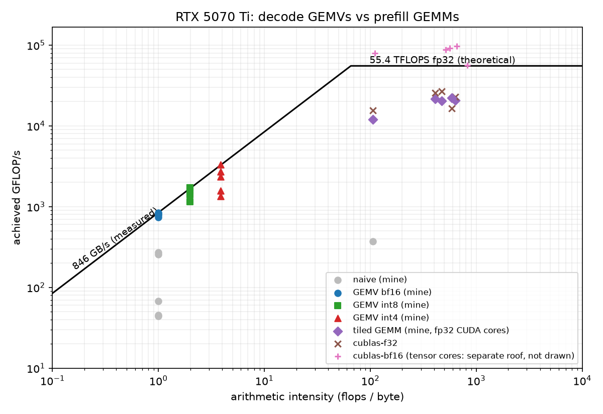

# infer

An LLM inference engine written from scratch in C++ and CUDA for Llama-3.2-1B: my own kernels
for every op, checked layer by layer against a PyTorch reference, with decode running at
**93% of the GPU's measured memory bandwidth** on an RTX 5070 Ti.

## Results

RTX 5070 Ti (Blackwell, 16 GB), driver 617.42, CUDA 13.3, WSL2. Llama-3.2-1B shapes with
random weights (speed depends only on the shapes; see Limitations). Batch size 1.

| | infer | llama.cpp v0.6.0 | transformers 5.19 (bf16, SDPA) |
|---|---:|---:|---:|
| decode, bf16 | **317 tok/s** (93% of measured bandwidth) | 243 tok/s | 59 tok/s |
| decode, 8-bit weights | **581 tok/s** (int8) | 384 tok/s (Q8_0) | |
| decode, 4-bit weights, same bytes per token | **775 tok/s** (int4, int8 head) | 549 tok/s (Q4_0, Q6_K head) | |
| decode, 4-bit everywhere | 887 tok/s (int4) | | |
| prefill, 2048 tokens | 9.4k tok/s | **30.2k tok/s** | 29.9k tok/s |

Decode after a 128-token prompt. Decode is where my kernels are: 1.3-1.5x llama.cpp at the
same weight format and bytes per token. Prefill is where they are not: llama.cpp and cuBLAS
use tensor cores and my GEMM runs on CUDA cores in fp32, so they are ~3x faster.

The bandwidth percentage is against **845.9 GB/s, the peak I measured on this card** with a
streaming read kernel (`bench/membw.cu`), not the spec sheet. A few big GEMVs measure slightly
above it (up to 102%), so that number is itself a little conservative.

<details>
<summary>All numbers (from <code>bench/summarize.py</code>)</summary>

Decode, batch 1, 128 new tokens after a prompt of the given length. tok/s is the median of 5 runs; GB/s is weights + KV cache read per step; peak = 845.9 GB/s measured.

| engine | weights read / token | ctx 128 tok/s | ctx 512 tok/s | ctx 2048 tok/s | % of peak (ctx 128) |
|---|---:|---:|---:|---:|---:|
| infer, naive kernels | 2.47 GB | 24.9 | 17.6 | 7.5 | 7.3% |
| infer bf16, no CUDA graph | 2.47 GB | 293.4 | 292.1 | 279.3 | 85.9% |
| infer bf16 | 2.47 GB | 317.1 | 313.6 | 300.4 | 92.9% |
| infer int8 | 1.24 GB | 581.0 | 573.0 | 539.8 | 85.5% |
| infer int4 (int8 LM head) | 0.77 GB | 774.8 | 750.0 | 681.3 | 70.7% |
| infer int4 | 0.64 GB | 886.8 | 845.5 | 758.9 | 67.5% |
| llama.cpp BF16 | | 243.2 | 261.3 | 256.4 | |
| llama.cpp Q8_0 | | 383.9 | 378.1 | 367.0 | |
| llama.cpp Q4_0 (Q6_K head) | | 548.6 | 500.0 | 494.8 | |
| transformers bf16 (sdpa) | | 59.2 | 58.8 | 52.6 | |
| transformers bf16 (eager) | | 38.5 | 35.2 | 38.9 | |

Prefill (prompt processing), tokens per second; time to first token in brackets for infer and transformers.

| engine | 128 tokens | 512 tokens | 2048 tokens |
|---|---:|---:|---:|
| infer, naive kernels | 176 (727 ms) | 186 (2753 ms) | 184 (11125 ms) |
| infer bf16 | 6429 (20 ms) | 9237 (55 ms) | 9351 (219 ms) |
| infer int8 | 7047 (18 ms) | 9602 (53 ms) | 9597 (213 ms) |
| infer int4 | 6933 (18 ms) | 9498 (54 ms) | 9431 (217 ms) |
| llama.cpp BF16 | 19436 | 31446 | 30189 |
| llama.cpp Q8_0 | 19800 | 36765 | 34901 |
| llama.cpp Q4_0 | 20875 | 37703 | 38727 |
| transformers bf16 (sdpa) | 5238 (24 ms) | 26923 (19 ms) | 29879 (69 ms) |
| transformers bf16 (eager) | 6437 (20 ms) | 17892 (29 ms) | 12787 (160 ms) |

Per kernel, Llama-3.2-1B decode shapes, inputs rotated through 256 MB so nothing is served from L2. Times are per launch, medians of graph-batched launches.

| kernel | naive us | optimized us | speedup | optimized GB/s | % of peak |
|---|---:|---:|---:|---:|---:|
| gemv qkv 3072x2048 | 186.0 | 16.0 | 12x | 786 | 93% |
| gemv o 2048x2048 | 186.1 | 11.4 | 16x | 735 | 87% |
| gemv gate_up 16384x2048 | 247.6 | 80.1 | 3x | 839 | 99% |
| gemv down 2048x8192 | 759.2 | 41.5 | 18x | 810 | 96% |
| gemv lm_head 128256x2048 | 2060.8 | 632.7 | 3x | 831 | 98% |
| attention decode ctx=512 | 1581.3 | 5.4 | 295x | 199 | 24% |
| attention decode ctx=2048 | 6352.8 | 11.1 | 572x | 379 | 45% |
| argmax V=128256 | 19.3 | 1.4 | 13x | 356 | 42% |

Quantized GEMVs (GB/s on the quantized bytes):

| kernel | bf16 us | int8 us | int4 us | int8 % of peak | int4 % of peak |
|---|---:|---:|---:|---:|---:|
| gemv qkv 3072x2048 | 16.0 | 9.0 | 8.0 | 83% | 48% |
| gemv o 2048x2048 | 11.4 | 7.3 | 6.2 | 69% | 42% |
| gemv gate_up 16384x2048 | 80.1 | 39.0 | 24.6 | 102% | 84% |
| gemv down 2048x8192 | 41.5 | 21.6 | 14.2 | 92% | 72% |
| gemv lm_head 128256x2048 | 632.7 | 307.5 | 159.2 | 101% | 101% |

Prefill GEMMs (TFLOPS):

| shape | naive | tiled (mine, fp32) | cuBLAS fp32 | cuBLAS bf16 tensor cores |
|---|---:|---:|---:|---:|
| gemm qkv T=128 | 0.4 | 12.1 | 15.6 | 79.5 |
| gemm qkv T=2048 |  | 20.5 | 26.8 | 91.1 |
| gemm o T=2048 |  | 21.7 | 25.7 | 88.0 |
| gemm gate_up T=2048 |  | 20.8 | 23.0 | 97.2 |
| gemm down T=2048 |  | 22.3 | 16.5 | 56.1 |

llama.cpp: `llama-bench -ngl 99 -fa 1 -r 5`, mean of 5 (decode is `tg128` at depth 128, 512
and 2048). Its Q8_0 and Q4_0 use blocks of 32 with fp16 scales and keep the tied embedding /
LM head in Q8_0 and Q6_K respectively; my int8 has one scale per row and my int4 one per 128.
Raw results, with the GPU state at the start of each run, are in `bench/results/m5-random-*`.
</details>


## Why bandwidth is the number that matters

At batch size 1, generating a token reads every weight once and does one multiply-add with
it: 2 flops per 2 bytes of bf16, one flop per byte. This GPU can do about 55 TFLOPS of fp32 on
its CUDA cores but move only ~850 GB/s, so anything below ~65 flops per byte is limited by
memory. Decode sits at 1, so the best possible decode speed is simply bandwidth divided by the
bytes per token, and the honest way to report a decode kernel is as a fraction of that.
Prefill reuses each weight once per prompt token, so at 2048 tokens it sits at hundreds of flops per
byte and is limited by arithmetic instead.



Decode GEMVs sit at the far left, on the bandwidth roof; nothing but fewer bytes moves them,
which is why weight-only quantization speeds decode up even though the math stays fp32.
Prefill GEMMs sit far right, under the compute roof, where my CUDA-core GEMM reaches ~40% of
the fp32 peak and cuBLAS on bf16 tensor cores is 4x faster again.

## Architecture

```
 token ──► Embedding ──► x (fp32 residual stream)
              │
              │ ×16 layers
              │   GEMV(RMSNorm(x) fused, Wqkv)          q | k | v
              │   RoPE, write k and v to the bf16 KV cache
              │   split-KV attention (one block per KV head, 16 splits) + merge
              │   x += GEMV(attn, Wo)                   residual fused
              │   GEMV(RMSNorm(x) fused, Wgate|up)      silu(gate) * up fused
              │   x += GEMV(act, Wdown)                 residual fused
              ▼
         GEMV(RMSNorm(x) fused, LM head) ──► logits ──► argmax / sampling ──► next token
```

The whole decode step (argmax, 115 kernel launches, position update) is captured once as a
CUDA graph and replayed per token; the position and the token live in device memory so the same
graph is valid at every step. Prefill runs the same layers with a tiled GEMM and a
FlashAttention-style kernel.

| Piece | Where |
|---|---|
| PyTorch reference (written from the architecture, checked against transformers) | `reference/llama.py` |
| safetensors loader (mmap), JSON parser, config | `src/safetensors.cpp`, `src/json.cpp`, `src/config.cpp` |
| Engine: KV cache, prefill/decode, CUDA graph, sampling loop | `src/engine.cpp` |
| Naive kernels (the baseline) | `src/kernels/naive.cu` |
| Decode GEMV (bf16 / int8 / int4) with fused norm, residual, SwiGLU | `src/kernels/gemv.cu` |
| Split-KV decode attention, RoPE + cache write, argmax | `src/kernels/decode.cu` |
| Tiled GEMM, flash-style prefill attention, RMSNorm | `src/kernels/prefill.cu` |
| Weight-only quantization | `src/kernels/quant.cu` |
| Temperature / top-k / top-p sampling | `src/kernels/sampling.cu` |
| Perplexity | `tools/perplexity.cpp`, `src/kernels/eval.cu` |

## Correctness

- **Reference vs transformers:** `reference/llama.py` matches Hugging Face transformers
  exactly on a tiny random model (difference 0.0 in fp32) and within 1e-3 on logits for the
  1B shapes.
- **Every kernel vs a CPU implementation:** 95 GoogleTest cases with explicit tolerances,
  including ragged shapes, ties in argmax, empty attention splits and bit-exact quantization.
  compute-sanitizer memcheck, racecheck and initcheck are clean.
- **Engine vs reference, layer by layer:** the residual stream after every layer, the prefill
  logits and the decode-path logits at every position, for every backend (naive, optimized,
  CUDA graph, int8, int4), plus 24 tokens of greedy generation that must match token for
  token. Quantized runs compare against a reference using the same quantized weights.
- **Perplexity tool vs a Python implementation of the same method.**

The KV cache is bf16, so the reference rounds K and V to bf16 too; the remaining differences
come from summation order (about 1e-3 relative on the 1B model, 1e-4 on the tiny one).

## Build, test, run

Linux (developed in WSL2 Ubuntu 24.04), CUDA 12.8+ (built with 13.3), CMake 3.25+, Ninja, a
C++20 compiler, and a GPU with compute capability 8.0 or newer.

```sh
cmake --preset release && cmake --build --preset release
ctest --preset release                 # C++ tests (GPU tests need a GPU)

scripts/setup_python.sh                # venv with torch + transformers
python -m pytest                       # reference + engine end-to-end tests

# Random weights with the real model's shapes (no download needed):
python -m reference.random_model reference/configs/llama-3.2-1b.json models/random-1b

build/release/infer --model models/random-1b --tokens 1,2,3 --generate 32
build/release/infer --model models/random-1b --tokens 1,2,3 --generate 32 --weights int4 \
    --temperature 0.6 --top-p 0.9 --seed 1
```

Benchmarks (on an idle GPU):

```sh
build/release/membw                    # peak bandwidth
bench/llamacpp/build.sh                # llama.cpp v0.6.0 with CUDA
bench/llamacpp/convert.sh models/random-1b ~/models/random-1b-gguf
bench/run_all.sh models/random-1b ~/models/random-1b-gguf m5-random
python3 bench/summarize.py bench/results m5-random
```

## Design decisions

- **bf16 weights, fp32 activations and accumulation, bf16 KV cache.** At batch 1 the weights
  are 2.47 GB per token and the activations a few KB, so fp32 activations cost nothing
  measurable and keep the reference comparison tight.
- **Fusion where it saves memory traffic or launches:** RMSNorm is applied while the GEMV
  stages its input, residual adds happen in the GEMV epilogue, SwiGLU is computed from paired
  gate/up rows. 7 launches per layer instead of 10.
- **GQA-aware split-KV attention:** one block per KV head serves its 4 query heads, so K and V
  are read once per step; 16 splits fill the GPU at long context.
- **Weight-only quantization with dequant in registers:** int8 per row, int4 per 128 (the
  largest-magnitude value maps to -8, as in llama.cpp's Q4_0). Nibbles are converted with the
  2^23 exponent trick instead of int-to-float instructions.
- **Sampling on the GPU** (radix select for the top-k and top-p cut-offs), with per-position
  random numbers from a seed, so a sampled step is still one CUDA graph and runs reproduce.

## Limitations

- One model architecture (Llama), batch size 1, one GPU.
- Prefill runs on CUDA cores in fp32; tensor cores (as cuBLAS uses) would make it ~4x faster.
- int4 decode reaches 65% of peak bandwidth: small int4 matrices are limited by staging the
  input vector per block and by instruction count, not by DRAM.
- The numbers above use random weights with Llama-3.2-1B's exact shapes, because Meta's
  checkpoint is gated and access was still pending. Speed depends only on the shapes, and
  correctness is checked against the reference with the same weights, but text quality and
  perplexity per weight format need the real checkpoint. The tools for that are ready
  (`scripts/prepare_wikitext.py`, `tools/perplexity`, llama.cpp's `llama-perplexity` on the
  same file).
- Developed and measured under WSL2; numbers on bare-metal Linux may differ slightly.
